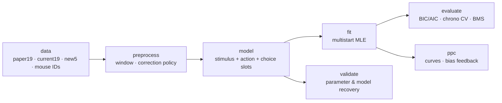

# rl_ladder

A modular framework for fitting, validating and comparing reinforcement-learning
models of mouse auditory category learning. It extends the RL analysis of
Collina et al. (2025), *Individual-specific strategies inform category
learning*, Sci Rep 15:2984, with a model ladder in the spirit of Wilson &
Collins (2019), *Ten simple rules for the computational modeling of behavioral
data*.

**Question.** The paper attributes early-learning bias drift to
"perseveration", but its choice-history term scales the reward prediction
error, so it is reward-dependent. Is the drift (a) reward-driven,
stimulus-independent learning, or (b) reward-independent repetition (a choice
kernel)? The ladder puts both mechanisms, one at a time and together, on top of
two learning bases, and checks that the comparison is identifiable before
interpreting it.

The design copies [PIDSMaker](https://github.com/ubc-provenance/PIDSMaker):
a pipeline of stages, each a slot whose method is chosen in YAML or on the
command line, with stage outputs cached by configuration hash.

## Architecture



Every model is the **same numba kernel** with different slots switched on. On
each trial:

```
logit = [stimulus term] + b + beta_v*(V_H - V_L) + beta_c*k + w*y_prev*(2r_prev - 1)
p     = sigmoid(logit) = P(choose High)
```

then Q, V and k update from the choice and reward. A switched-off module sits
at a neutral value (e.g. `beta_c = 0`), so its term is exactly zero and the
ladder is nested by construction. The kernel scores observed choices (fit) and
generates synthetic ones (simulation) in one loop, so the two cannot drift
apart.

| slot | variants | meaning |
|---|---|---|
| `stimulus` | `none` · `S` · `S_cf` · `A` | stimulus-specific learning. `S`: Q(s,a) with free inverse temperature. `A`: the original code, Q(a) read through the stimulus, temperature fixed at 5 |
| `action` | `none` · `V` · `gamma` · `wsls` | reward-dependent, stimulus-independent. `V`: action values. `gamma`: the paper's choice-history coupling (needs `A`). `wsls`: noisy win-stay/lose-shift |
| `choice` | `none` · `ck` | reward-independent repetition: exponential choice kernel; `beta_c > 0` perseveration, `< 0` alternation |

### The core ladder (`config/models.yml`, set `core`)

| model | stimulus | action | choice | k | note |
|---|---|---|---|---|---|
| M1 | – | – | – | 1 | bias only |
| M2 | – | wsls | – | 1 | noisy WSLS |
| S0 | S | – | – | 4 | |
| S+R | S | V | – | 6 | |
| S+C | S | – | ck | 6 | |
| S+R+C | S | V | ck | 8 | |
| A0 | A | – | – | 3 | paper's "simple" model |
| A+R | A | gamma | – | 4 | paper's "choice-history" model, gamma = exp(−beta) |
| A+C | A | – | ck | 5 | |
| A+R+C | A | gamma | ck | 6 | |

`python -m rl_ladder list models` shows every registered model, including the
optional variants (`S0cf`, `A0T`, stimulus-blind `V`, `C`, `V+C`, and the
fixed-temperature S family `S_fixed`).

## Quick start (local)

```bash
cd rl_ladder
scripts/setup_env.sh venv          # once; or reuse an existing env (see Environment)
source scripts/activate.sh         # sets PYTHONPATH, RL_LADDER_DATA, thread limits
scripts/test.sh                    # 94 tests, ~10 s
scripts/run_experiment.sh replicate_paper --n-jobs 8
```

Single runs work like PIDSMaker's `main.py SYSTEM DATASET --overrides`:

```bash
scripts/run_local.sh A+R paper19                              # one model, 19 mice
scripts/run_local.sh core GS027 --fit.n_starts=40 --n-jobs 8  # a model set, one mouse
scripts/run_local.sh S+C,A+C paper19 --preprocess.correction=include
scripts/run_local.sh A+R GS040 --task ppc --ppc.n_sims=100
scripts/run.sh core paper19 --n-jobs 8                        # same, in the background
```

Experiments (`config/experiments/*.yml`) name a task, models, datasets, fixed
overrides and an optional grid:

| experiment | task | what it does |
|---|---|---|
| `replicate_paper` | fit | gate: A0/A+R with the paper's settings; compares NLL with the published fits and counts drifting/stationary preferences |
| `core_ladder` | fit | 10 models × 19 mice × {whole learning period, first 3 sessions} |
| `sensitivity` | fit | correction policy × session-reset assumptions |
| `param_recovery` | param_recovery | 100 prior draws per model, refit the same model |
| `model_recovery` | model_recovery | 50 datasets per model from fitted parameters, fit all 10 |
| `ppc` | ppc | learning curves and bias feedback for S0/S+R/S+C/A0/A+R/A+C |
| `smoke`, `smoke_recovery` | – | one-minute installation checks |

## Configuration

Precedence (later wins): `config/default.yml` < dataset preset < experiment
`overrides` < grid point < command line. Every key in `default.yml` can be
overridden with `--stage.key=value`; unknown keys are errors, so typos fail
loudly.

| stage | key settings |
|---|---|
| `data` | `variant` (`paper` uses the published windows for GS028/JC052), `unknown_ct` |
| `preprocess` | `window.method` (`all`, `first_sessions`, `last_sessions`), `correction` (`mask`, `include`, `drop`) |
| `model` | `session_reset`: which slot states restart each session |
| `fit` | `n_starts`, `warm_start_from_nested`, `seed` |
| `evaluate` | `cv.method` (`none`, `chrono`) |
| `validate` | `n_reps`, `param_source` (`prior`, `fitted`), `env` (`reactive`, `replay`), `accuracy_range` |
| `ppc` | `n_sims`, `env`, `block`, `analyses` |
| `collect` | `contrasts`, `groups`, `reference` |

**Correction trials.** Default `mask`: they update the model's state but are
left out of the likelihood, because their stimulus is predictable from the
previous error. `include` reproduces the paper.

**Adding a model** that recombines existing variants is one line in
`config/models.yml`. **Adding a module** (a new mechanism): prototype it as a
class in `rl_ladder/models/reference.py` (`reset / term / update`), give it a
slot in `kernel.py` and parameters in `params.py`, register the variant in
`registry.py`, and the kernel-vs-reference tests check the two match.

## Outputs and caching

```
results/
  cache/fits/<model>/<mouse>/<key>.json   one fit; key = hash(model, data checksum,
                                          data/preprocess/model/fit/evaluate settings, code)
  runs/<run>/plan.json                    the expanded units
  runs/<run>/<variant>/<task>/<unit>.json one unit's result
  runs/<run>/summary/                     tables and figures from `collect`
```

Fits are shared between runs: `ppc` and `model_recovery` reuse the fits made by
`core_ladder` when the settings match. Changing a scientific source file
(`models/`, `fit/`, `data.py`, …) changes the code checksum and therefore every
key, so stale results are never reused. Rerunning a plan skips units that are
already done.

`collect` writes, for fits: `fits.csv`, `bic_wide__*.csv`, `best_counts.csv`,
`bms.csv` (random-effects BMS with protected exceedance probabilities, at the
model level and per slot family), `contrasts.csv`, `replication.csv`. For
recovery: parameter tables and correlations, confusion and inversion matrices,
and figures. For PPC: `ppc.csv`.

## Running on Firebird (Slurm)

```bash
scripts/slurm/submit.sh core_ladder --chunk 10 --time 01:00:00
scripts/slurm/submit.sh model_recovery --chunk 2 --time 02:00:00
```

`submit.sh` writes a plan, submits a job array (one index = `--chunk` units)
and a collect job that runs afterwards. Step-by-step instructions, in Chinese:
[FIREBIRD.md](FIREBIRD.md).

## Environment

Python 3.11. Pinned in `requirements.txt` to the versions already validated in
the `mice-rl` environment on Firebird, plus PyYAML and pytest:

| package | version | used for |
|---|---|---|
| numpy | 1.26.3 | arrays |
| scipy | 1.16.0 | L-BFGS-B, special functions (BMS) |
| numba | 0.67.0 | the likelihood/simulation kernel |
| pandas | 2.2.0 | summary tables |
| matplotlib | 3.11.0 | recovery figures (optional) |
| PyYAML | 6.0.3 | configuration files |
| pytest | 9.1.1 | tests |

The test suite also passes with numpy 2.4 / scipy 1.17 / pandas 3.0.

| environment variable | meaning |
|---|---|
| `RL_LADDER_DATA` | folder with `<MOUSE>.npz` (+ `paper/`); `activate.sh` finds the usual locations |
| `RL_LADDER_RESULTS` | results folder (default `rl_ladder/results`) |
| `RL_LADDER_REFERENCE` | folder with `reference_legacy.json` (default `<data>/../validation`) |
| `RL_LADDER_ENV` / `RL_LADDER_VENV` | conda env name / virtualenv path for `activate.sh` |
| `RL_LADDER_PARTITION` | default Slurm partition for `submit.sh` |

## Data

No data are stored in this repository. The framework reads the curated
per-mouse `.npz` files produced by the thesis preprocessing (fields `choice`,
`answer`, `reward`, `session`, `trial_type`). Correction trials are
`trial_type` 2 **and** 4 (both always follow an error and repeat the
stimulus). For files without trial types (JC039, and the paper windows of
GS028/JC052) correction trials are inferred from the task rule.

## Validation status

- The kernel equals an independent pure-Python implementation, trial by
  trial, for all 15 registered models and four session-reset policies.
- It reproduces all 38 published A0/A+R log-likelihoods (19 mice) to within
  1e-10, and the thesis M1/M2 baselines.
- Refitting A0/A+R with this optimiser reaches the published NLL or slightly
  better for all 38 fits, and reproduces the paper's 5/8 drifting vs 0/9
  stationary preference for A+R.
- Nesting is exact; simulated and scored probabilities are identical; the
  reactive environment follows the original correction-trial rule.

## Known issues and open items

- **S family identifiability.** With a free `beta_q`, the mouse data constrain
  only `alpha * beta_q`: fits drift to `alpha -> 0`, `beta_q -> inf`, with `b`
  at its bound and only tiny likelihood gains. Fixing `beta_q`, as the paper
  fixes the A temperature, gives a well-defined optimum. The `S_fixed` set
  (`S0f`, `S+Rf`, `S+Cf`, `S+R+Cf`) is provided for this; which S family is
  primary is a scientific decision that parameter recovery should inform.
- `fit.method: bads` / `hierarchical` and `ppc.analyses: dtw` are planned and
  raise `NotImplementedError`.
- BIC is unreliable at parameter bounds; check `at_bound` in `fits.csv`.
