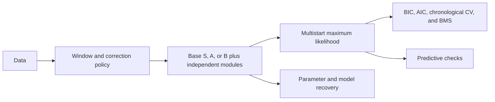

# rl_ladder

For the verified 18-model recovery workflow (v0.2.4), start with
[MODEL_RECOVERY.md](MODEL_RECOVERY.md).

A modular framework for fitting, validating and comparing reinforcement-learning
models of mouse auditory category learning. It extends the RL analysis of
Collina et al. (2025), *Individual-specific strategies inform category
learning*, Sci Rep 15:2984, with a model ladder in the spirit of Wilson &
Collins (2019), *Ten simple rules for the computational modeling of behavioral
data*.

**Question.** After accounting for the current sound, how much do reward-based
value learning, reward-independent choice repetition, and choice-feedback
history improve predictions of mouse choices and bias drift?

The ladder compares additions within a base and checks whether conclusions
hold across bases. It does not identify a unique psychological mechanism just
because one model has the lowest BIC. In particular, the original B coupling
and an independent V term are different mechanisms, so this is a comparison
across architectures, not a strictly orthogonal factorial design.

## Names and mechanisms

| name | mechanism | implementation |
|---|---|---|
| **S0** | stimulus-specific reward learning | Q(sound, action), chosen-cell RW update |
| **A0** | original Simple model | action associations read through the current sound |
| **B0** | original Choice-history model | A's update plus opposite coupling of the unchosen Q |
| **R** in S+R | additional action-value learning | independent V(action), chosen-action RW update |
| **C** | choice history, independent of reward | choice kernel; unchanged from version 0.1 |
| **F** | choice-feedback history | exponential filter of signed choice times signed feedback |

B0 was previously called **A+R**; B+C was **A+R+C**. The B coupling is part
of the base, not an additive R term. Old command-line names resolve to the
new names with a warning; only canonical names enter new plans and outputs.
M1 (bias only) and M2 (noisy one-trial WSLS) remain available.

F implements the reward-history equation in Lebedeva et al. (2026),
[Dorsal prefrontal cortex drives perseverative behavior in mice](https://www.nature.com/articles/s41467-026-71664-w).
C corresponds to that paper's P; **F+C** has its PR decision rule. Reset both
`choice` and `feedback` each session to match the paper's initialization.
Our loader and simulator still implement auditory categorization with
deterministic rewards, not that paper's probabilistic reversal task.

**Interpretation:** in this dataset, signed choice times signed feedback
is exactly the signed stimulus category. F is therefore also a stimulus-history
filter. It cannot by itself distinguish reward learning from stimulus history.
This is recorded as `feedback_interpretation` in fit outputs and summaries.

## Complete cross-validation records

Version 0.2.1 adds a **CV-only task** with saved training parameters, per-start
optimizer diagnostics, explicit session splits, data/source checksums and the
numerical environment. `verify-cv` reevaluates saved scores without refitting.
Existing full-data fits and version 0.2.0 results remain separate.

See [CV_RECORDS.md](CV_RECORDS.md) for the record schema and the small-check/full
Firebird workflow. The new experiments are `smoke_cv_audit` (6 units) and
`feedback_cv_audit` (456 units). Resource requests are 1 CPU and 2 GB per task.
Local test and actual-data check results are recorded in
[CV_VALIDATION.md](CV_VALIDATION.md).

## Architecture

The design follows [PIDSMaker](https://github.com/ubc-provenance/PIDSMaker):
configuration selects each stage, with outputs cached by configuration and
source checksums.



| slot | choices | role |
|---|---|---|
| `stimulus` | `none`, `S`, `S_cf`, `A`, `B` | value-learning base; B owns gamma |
| `action` | `none`, `V`, `wsls` | action values or one-trial WSLS |
| `choice` | `none`, `ck` | reward-independent choice history C |
| `feedback` | `none`, `cf` | choice-feedback history F |

A single numba loop predicts before updating each trial's states. Fitting and
simulation share that loop. The independent Python reference uses the paper's
weighted PR equations to check the normalized kernel implementation.

### Model combinations

| base | base only | + C | + F | + F + C |
|---|---|---|---|---|
| S | S0 | S+C | S+F | S+F+C |
| A | A0 | A+C | A+F | A+F+C |
| B | B0 | B+C | B+F | B+F+C |

The complete S-family comparison includes **S+R**, **S+R+C**, **S+R+F** and
**S+R+F+C**, alongside the four S controls in the table. R is the independent
action value V; F does not replace it. `reward_ladder` fits all eight S models
with full-data BIC and chronological CV, including training-parent starts.
See [REWARD_LADDER.md](REWARD_LADDER.md) for the model matrix and Firebird steps.
The test and actual-data checks are recorded in [REWARD_VALIDATION.md](REWARD_VALIDATION.md).

Model sets:

- `core`: 18 models, including the complete eight-model S family and M1/M2 baselines.
- `core_original`: the original 10 with canonical B names.
- `feedback`: the 12 models in the table.
- `feedback_fixed`: the same comparison with the S temperature fixed at 5.
- `paper`: A0 and B0 for the original study's replication gate.
- `S`, `S_extended`: the same complete eight-model S family.
- `reward_extension`: the four R-containing S models.
- `A`, `B`: the four C/F combinations on each original base.
- `S_fixed`: eight S variants with temperature 5; this is a sensitivity analysis.
- `blind`: M1, V, C, V+C, F, F+C (no current-sound term).

`python -m rl_ladder list models` shows all registered models. Optional
variants also include `S0cf` (counterfactual updating) and `A0T` (free temperature).

## Quick start (local)

For the current primary-model experiment, start with
[MAIN_EXPERIMENT.md](MAIN_EXPERIMENT.md): 18 models, 684 old-cohort fit/CV
outputs, and a separate 180-output new-cohort run. The 15 supplementary
variants are excluded. Use `scripts/slurm/submit_main_ladder.sh smoke` first.
Preparation checks are recorded in [MAIN_VALIDATION.md](MAIN_VALIDATION.md).

```bash
cd rl_ladder
scripts/setup_env.sh venv          # once; or reuse an existing env (see Environment)
source scripts/activate.sh         # sets PYTHONPATH, RL_LADDER_DATA, thread limits
scripts/test.sh                    # includes data-dependent replication gates
scripts/run_experiment.sh replicate_paper --n-jobs 8
```

Single runs work like PIDSMaker's `main.py SYSTEM DATASET --overrides`:

```bash
scripts/run_local.sh B0 paper19                              # one model, 19 mice
scripts/run_local.sh core GS027 --fit.n_starts=40 --n-jobs 8  # a model set, one mouse
scripts/run_local.sh S+F+C,B+F+C paper19 --preprocess.correction=include
scripts/run_local.sh B0 GS040 --task ppc --ppc.n_sims=100
scripts/run.sh core paper19 --n-jobs 8                        # same, in the background
```

Experiments (`config/experiments/*.yml`) name a task, models, datasets, fixed
overrides and an optional grid:

| experiment | task | what it does |
|---|---|---|
| `main_ladder` | fit + recorded CV | current primary comparison: 18 models × 19 mice × two reset policies (684 units) |
| `smoke_main_ladder` | fit + recorded CV | all 18 primary models on GS029, both policies (36 units) |
| `main_new_mice` | fit + recorded CV | the same protocol on five new mice, separately summarized (180 units) |
| `main_model_recovery`, `main_param_recovery` | recovery | primary 18 only, both policies; explicitly submitted validation stages |
| `smoke_model_recovery`, `recovery_main_old`, `recovery_main_new` | model_recovery | v0.2.4 audited recovery; balanced old/new templates, all 18 candidates; see `MODEL_RECOVERY.md` |
| `replicate_paper` | fit | gate: A0/B0 with the paper's settings; compares NLL with the published fits and counts drifting/stationary preferences |
| `core_ladder` | fit | 18 models × 19 mice × {whole learning period, first 3 sessions} |
| `sensitivity` | fit | correction policy × session-reset assumptions |
| `param_recovery` | param_recovery | 100 prior draws per model, refit the same model |
| `model_recovery` | model_recovery | 50 datasets per model from fitted parameters, fit all 18 |
| `ppc` | ppc | learning curves and bias feedback for S0/S+R/S+C/A0/B0/A+C |
| `feedback_ladder` | fit | 12-model C/F comparison with two session-reset policies |
| `feedback_recovery` | model_recovery | 12-model recovery from prior draws, without accuracy rejection |
| `feedback_ladder_fixed`, `feedback_recovery_fixed` | fit / model_recovery | corresponding comparisons with the S temperature fixed at 5 |
| `feedback_param_recovery` | param_recovery | parameter recovery without accuracy rejection |
| `smoke_feedback` | fit | small real-data check including independent V, C, and F |
| `reward_ladder` | fit | all eight S-family R/C/F combinations; 19 mice × two C-reset policies, full-data fits and recorded CV |
| `smoke_reward_ladder` | fit | eight S-family models on GS029 under both reset policies (16 units) |
| `reward_ladder_fixed` | fit | the same complete comparison with S temperature fixed at 5 |
| `reward_model_recovery` | model_recovery | all eight S-family models; 50 prior datasets per model |
| `reward_param_recovery` | param_recovery | the four R-containing models; 100 prior datasets per model |
| `smoke_feedback_recovery` | model_recovery | tiny fixed-temperature recovery check; not a scientific recovery study |
| `smoke`, `smoke_recovery` | – | installation checks |

## Configuration

Precedence (later wins): `config/default.yml` < dataset preset < experiment
`overrides` < grid point < command line. Every key in `default.yml` can be
overridden with `--stage.key=value`; unknown keys are errors, so typos fail
loudly.

| stage | key settings |
|---|---|
| `data` | `variant` (`paper` uses the published windows for GS028/JC052), `unknown_ct` |
| `preprocess` | `window.method` (`all`, `first_sessions`, `last_sessions`), `correction` (`mask`, `include`, `drop`) |
| `model` | `session_reset`: which slot states restart each session (including `feedback`) |
| `fit` | `n_starts`, `warm_start_from_nested`, `seed` |
| `evaluate` | `cv.method` (`none`, `chrono`) |
| `validate` | `n_reps`, `param_source` (`prior`, `fitted`), `env` (`reactive`, `replay`), `accuracy_range` |
| `ppc` | `n_sims`, `env`, `block`, `analyses` |
| `collect` | `contrasts`, `groups`, `reference` |

**Correction trials.** Default `mask`: they update the model's state but are
left out of the likelihood, because their stimulus is predictable from the
previous error. `include` reproduces the paper.

**Adding a model** that recombines existing variants is one line in
`config/models.yml`. **Adding a module** (a new mechanism): prototype it as a
class in `rl_ladder/models/reference.py` (`reset / term / update`), give it a
slot in `kernel.py` and parameters in `params.py`, register the variant in
`registry.py`, and the kernel-vs-reference tests check the two match.

## Outputs and caching

```
results/
  cache/fits/<model>/<mouse>/<key>.json   one fit; key = hash(model, data checksum,
                                          data/preprocess/model/fit/evaluate settings, code)
  runs/<run>/plan.json                    the expanded units
  runs/<run>/<variant>/<task>/<unit>.json one unit's result
  runs/<run>/summary/                     tables and figures from `collect`
```

Fits are shared between runs: `ppc` and `model_recovery` reuse the fits made by
`core_ladder` when the settings match. Changing a scientific source file
(`models/`, `fit/`, `data.py`, …) changes the code checksum and therefore every
key, so stale results are never reused. Rerunning a plan skips units that are
already done.

`collect` writes, for fits: `fits.csv`, `bic_wide__*.csv`, `best_counts.csv`,
`bms.csv` (random-effects BMS with protected exceedance probabilities, at the
model level and per slot family), `contrasts.csv`, `replication.csv`. For
recovery: parameter tables and correlations, confusion and inversion matrices,
and figures. For PPC: `ppc.csv`.

## Running on Firebird (Slurm)

```bash
scripts/slurm/submit.sh core_ladder --chunk 10 --time 01:00:00
scripts/slurm/submit.sh model_recovery --chunk 2 --time 02:00:00
```

`submit.sh` writes a plan, submits a job array (one index = `--chunk` units)
and a collect job that runs afterwards. See the Environment and Data sections
below for setup and input requirements.

## Environment

Python 3.11. Pinned in `requirements.txt` to the versions already validated in
the `mice-rl` environment on Firebird, plus PyYAML and pytest:

| package | version | used for |
|---|---|---|
| numpy | 1.26.3 | arrays |
| scipy | 1.16.0 | L-BFGS-B, special functions (BMS) |
| numba | 0.67.0 | the likelihood/simulation kernel |
| pandas | 2.2.0 | summary tables |
| matplotlib | 3.11.0 | recovery figures (optional) |
| PyYAML | 6.0.3 | configuration files |
| pytest | 9.1.1 | tests |

The test suite also passes with numpy 2.4 / scipy 1.17 / pandas 3.0.

| environment variable | meaning |
|---|---|
| `RL_LADDER_DATA` | folder with `<MOUSE>.npz` (+ `paper/`); `activate.sh` finds the usual locations |
| `RL_LADDER_RESULTS` | results folder (default `rl_ladder/results`) |
| `RL_LADDER_REFERENCE` | folder with `reference_legacy.json` (default `<data>/../validation`) |
| `RL_LADDER_ENV` / `RL_LADDER_VENV` | conda env name / virtualenv path for `activate.sh` |
| `RL_LADDER_PARTITION` | default Slurm partition for `submit.sh` |

## Data

No data are stored in this repository. The framework reads the curated
per-mouse `.npz` files produced by the thesis preprocessing (fields `choice`,
`answer`, `reward`, `session`, `trial_type`). Correction trials are
`trial_type` 2 **and** 4 (both always follow an error and repeat the
stimulus). For files without trial types (JC039, and the paper windows of
GS028/JC052) correction trials are inferred from the task rule.

## Version 0.2 validation and migration

- Tests compare every model against the independent reference under six reset
  policies, including separate and joint C/F resets.
- Direct PR-equation tests cover all four choice/feedback outcomes, session
  boundaries, likelihood masking, and prediction before feedback is observed.
- F at weight zero exactly recovers its parent. B0 at gamma zero recovers A0.
- Data-dependent tests reevaluate all 38 published A0/B0 likelihood targets and
  the thesis M1/M2 baselines. They skip when the local data/reference files
  are absent; a skip does not establish successful replication.
- Existing raw result files are not renamed or edited. New source and model
  hashes produce new fit cache keys. Use a **new run name** (`--name-suffix _v020`)
  for the changed ladder; an old plan cannot resume with changed scientific code.
- Plotting accepts historical A+R/A+R+C labels and retains optional F models.
- When successful and unsuccessful starts differ only by numerical precision,
  the fitter prefers a converged solution within an absolute total-NLL gap of
  1e-7. A materially better unsuccessful start remains flagged as unsuccessful.
- See [METHODS.md](METHODS.md) for equations, parameter ranges, and limitations.

## Known issues and open items

- **S family identifiability.** Existing fits suggest a tradeoff between
  learning rate and inverse temperature in some regimes. A stable fixed-temperature
  fit does not prove unique or biologically meaningful parameters. Compare
  `feedback` with `feedback_fixed` and inspect parameter recovery before choosing
  a primary S specification.
- At zero C/F weight, that module's learning rate is unidentifiable by design.
  Recovery should report where models and parameters can be distinguished,
  rather than expect perfect classification at every parameter setting.
- `fit.method: bads` / `hierarchical` and `ppc.analyses: dtw` remain planned and
  raise `NotImplementedError`.
- BIC is unreliable at parameter bounds; inspect `at_bound`, convergence,
  held-out prediction, and simulated behavior together.
